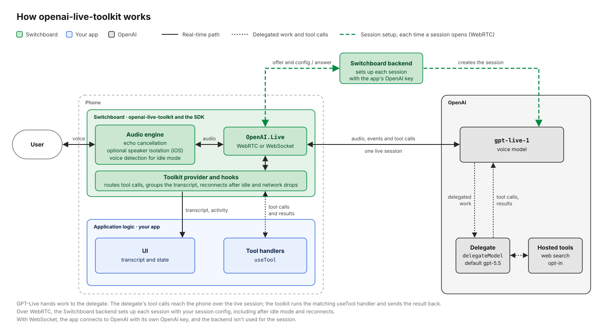

# Full-duplex voice agents in React Native

OpenAI's GPT-Live (`gpt-live-1.1`) is a full-duplex voice model. It listens while it speaks and decides for itself when to take a turn, when to back off, and when someone has interrupted it. There is no turn detection to configure and no barge-in to tune. Conversations feel closer to talking with a person.

Switchboard's OpenAI Live Toolkit (`@synervoz/openai-live-toolkit`) puts that model in a React Native app. One provider and two hooks handle the GPT-Live session, microphone and speaker I/O, platform echo cancellation, tool calls into your app, and a live transcript of both sides. It's built on the [Switchboard SDK](https://docs.switchboard.audio/).

| Platform | Status    |
| -------- | --------- |
| iOS      | Supported |
| Android  | Supported |

## Demo

**▶ [Watch the demo on Loom](https://www.loom.com/share/24891dc7c0a74a3c9e3489d80a08f7fd)** (3½ min)

The [example app](example/README.md) running on an iPhone. It opens with talking over the model mid-answer, which GPT-Live handles without any barge-in settings. Then "what time is it?" and "make the background dark blue" run through two `useTool` hooks while the conversation continues.

## What the GPT-Live API leaves out

GPT-Live makes the conversation itself easy: speech goes up, speech comes back, and the model handles the turn-taking in between. What it gives you is a connection and an audio stream. Building an app on it still means solving:

- **Capture and playback.** Pulling audio off the microphone and playing the reply through the right audio route, at matching sample rates, in real time. The model streams audio continuously, silence included, so playback has to keep pace.
- **The microphone hearing the speaker.** A full-duplex model never stops listening. On speakerphone it hears its own voice the whole time it talks, unless acoustic echo cancellation removes it first.
- **Tool calls.** GPT-Live doesn't call functions. It hands work to a separate Responses model, which does, and it only hands off work it knows your app can do.
- **A transcript.** Both sides arrive as interleaved fragments that need grouping into lines.
- **Staying connected.** The session has to survive the screen locking and the app going to the background.

This toolkit is that layer.

## The easy part

```sh
npm install @synervoz/openai-live-toolkit
cd ios && bundle exec pod install
```

Wrap your app, call the hook, register a tool, press the button.

```tsx
import { Text, TouchableOpacity } from 'react-native'
import {
    OpenAILiveToolkitProvider,
    useOpenAILiveToolkit,
    useTool,
} from '@synervoz/openai-live-toolkit'

export default function App() {
    return (
        <OpenAILiveToolkitProvider instructions="You are a terse, friendly voice assistant.">
            <Screen />
        </OpenAILiveToolkitProvider>
    )
}

function Screen() {
    const { isRunning, start, stop } = useOpenAILiveToolkit()

    // Something the agent can actually do. Ask it the time.
    useTool({
        name: 'get_time',
        description: 'Get the current time.',
        handler: () => ({ time: new Date().toLocaleTimeString() }),
    })

    return (
        <TouchableOpacity onPress={isRunning ? stop : start}>
            <Text>{isRunning ? 'Stop' : 'Start talking'}</Text>
        </TouchableOpacity>
    )
}
```

That is a working voice agent, tool call included. `start()` requests the microphone, builds the audio graph with echo cancellation on, and opens the session. `useTool` tells the model the tool exists and routes the call to your handler; the return value goes back automatically. Talk over the agent and GPT-Live handles the interruption itself.

## How it works



The audio engine, the `OpenAI.Live` node and the toolkit's provider run on the phone. Audio, events and tool calls share one live session with OpenAI, so a tool call never leaves the conversation. With the default `webrtc` transport, the Switchboard backend sets up each session with your Switchboard app's OpenAI key, and the app ships without one ([Credentials](docs/getting-started.md#credentials)). [Tools](docs/tools.md) covers how delegation works.

## Tools

`useTool` scales up to anything your app can do. It takes JSON Schema parameters and can change state or call your backend. Register a `set_background_color` tool and "make the background dark blue" repaints the screen. Handlers run while the conversation continues, so a slow one doesn't freeze the voice. See [Tools](docs/tools.md) for how delegation works, dynamic tool sets, and what happens when a handler throws.

## Before you ship

- **The OpenAI key stays on the backend.** By default the session runs over WebRTC, and the Switchboard backend creates it with your Switchboard app's OpenAI key, so the app ships without one. The `websocket` transport needs the key in the app.
- **Billing.** GPT-Live bills per second of session, including while the app is backgrounded. Stop the engine when the conversation ends, or set `idleTimeoutMs` to close the session during silences and reopen it when the user speaks ([Idle mode](docs/getting-started.md#idle-mode)). Over WebRTC, `standbyTimeoutMs` pauses the model in short silences at a lower rate and resumes it in about half a second ([Standby](docs/getting-started.md#standby)).
- **iOS 15.1**, React Native's minimum. Android needs API 24 and an app built with NDK 29 ([Android setup](docs/getting-started.md#android-setup)).

## Documentation

- [Getting started](docs/getting-started.md) covers install, frameworks, iOS and Android setup, and credentials.
- [Tools](docs/tools.md) covers `useTool`, delegation, dynamic tool sets, and tool errors.
- [Media](docs/media.md) is optional: radio and podcasts alongside the conversation, which the model can control, and Now Playing. The example app's Radio screen is one implementation.
- [API reference](docs/api-reference.md) covers the provider, the `useOpenAILiveToolkit()` hook, every export, and the error codes.
- [Example app](example/README.md) has two screens: Basics, with a transcript, mute, and two tools, and Radio, an example implementation of media.
- The [`OpenAI.Live` node](https://docs.switchboard.audio/extensions/openai/openai-live-node/) in the Switchboard docs is what the toolkit runs on. Use it directly in native iOS, Android, macOS and Linux apps.

## Questions

Open an [issue](https://github.com/switchboard-sdk/openai-live-toolkit/issues) for bugs and questions.
